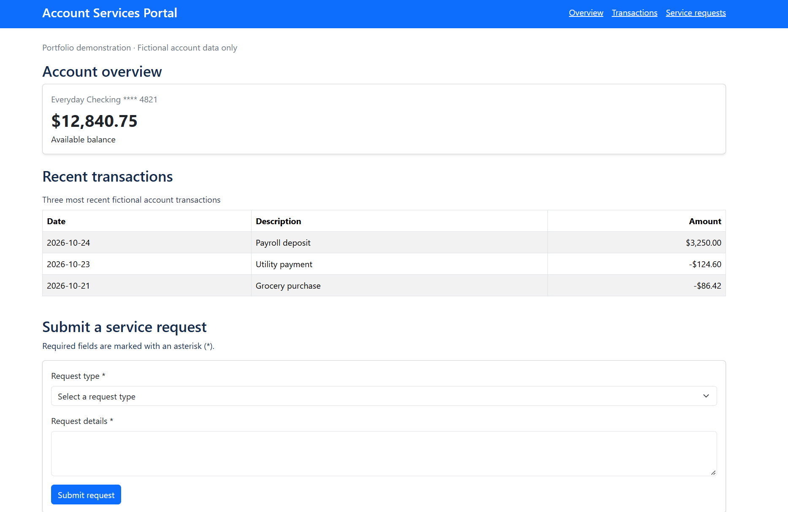

## Application Screenshot




# Account Services Portal

An accessibility-focused, full-stack portfolio application built with **Angular 22, TypeScript, Bootstrap, and ASP.NET Core 8 Web API**.

The project demonstrates front-end development, API integration, semantic HTML, accessible form design, and responsive UI implementation.

## Technology Stack

- **Frontend:** Angular 22, TypeScript, HTML5, CSS3, Bootstrap
- **Backend:** ASP.NET Core 8, C#
- **API:** RESTful HTTP endpoints returning JSON
- **Accessibility:** WCAG 2.1 AA-oriented design, ARIA attributes, keyboard navigation, axe DevTools

## Features

- Account overview with account details and available balance
- Recent transactions retrieved from the ASP.NET Core API
- Service-request form with required-field validation
- Dynamic feedback messages and a list of submitted requests
- Responsive layout using Bootstrap
- Fictional financial data for demonstration purposes

Service requests are stored in the application's in-memory client-side state and are not submitted to the API or persisted.

## Accessibility Implementation

The application includes:

- Semantic page landmarks and heading hierarchy
- Skip-to-main-content navigation
- Keyboard-accessible links and form controls
- Visible keyboard focus
- Explicit form labels and required-field indicators
- `aria-invalid` and `aria-describedby` for validation feedback
- Status messages for form submission
- Properly labeled navigation and table column headers

## Accessibility Testing

**Automated testing**

- Tool: axe DevTools (axe-core 4.13.0)
- Standard: WCAG 2.1 AA
- Result: **0 automated accessibility violations detected** on the initial scanned page state

**Manual testing**

- Keyboard navigation: Passed
- Skip navigation: Passed
- Form validation and submission feedback: Passed

Automated testing does not establish full WCAG conformance. Additional screen-reader and interaction-state testing may be necessary.

## Running the Application Locally

### Prerequisites

- Node.js and npm
- Angular CLI
- .NET 8 SDK

### Start the backend

From the `AccountServicesApi` directory:

```powershell
dotnet run --urls http://localhost:5000
```

### Start the frontend

From the `account-services-ui` directory:

```powershell
npm install
ng serve
```

On Windows PowerShell environments where npm scripts are restricted, use `npm.cmd install` and `ng.cmd serve`.

Open `http://localhost:4200`.

The Angular frontend communicates with the ASP.NET Core API at `http://localhost:5000`.

## API Endpoints

| Method | Endpoint | Description |
|---|---|---|
| GET | `/api/accounts` | Retrieves fictional account information |
| GET | `/api/transactions` | Retrieves recent fictional transactions |
| GET | `/api/health` | Returns API health status |

## Project Structure

```text
AccountServicesPortal/
├── account-services-ui/    # Angular frontend
├── AccountServicesApi/     # ASP.NET Core Web API
├── .gitignore
└── README.md
```

## Disclaimer

This is an independent portfolio demonstration using fictional data. It is not affiliated with any financial institution or government agency.